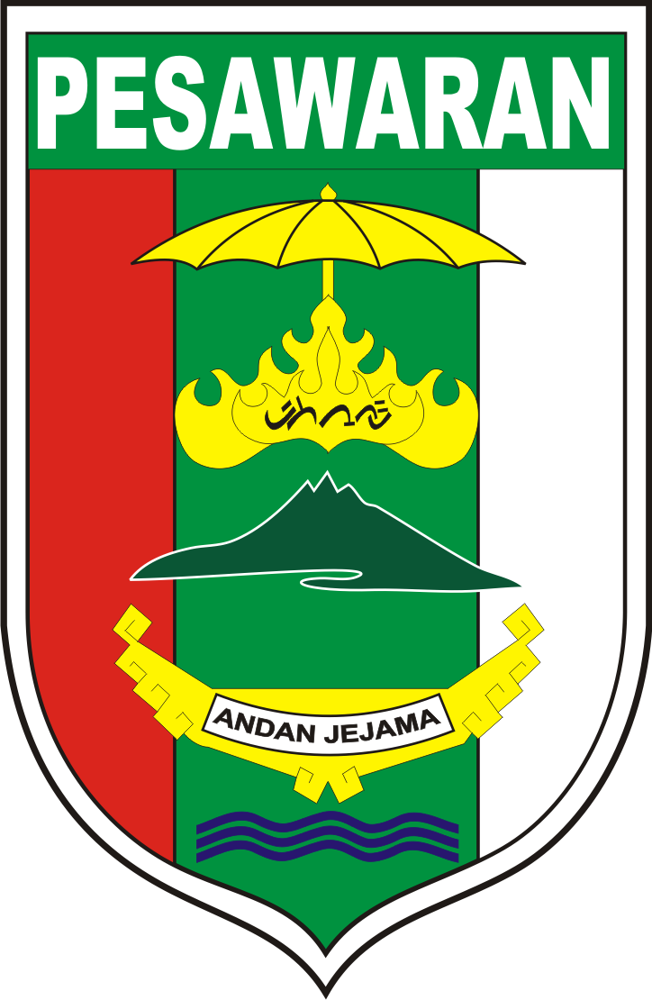

<p align="center">
  
</p>

<h1 align="center">SISTEM INFORMASI DESA KHEPONG JAYA</h1>

<p align="center">
  <strong>Portal Web Pemerintahan Desa Modern 100% Dinamis (Zero Hardcode)</strong><br>
  Kecamatan Padang Cermin, Kabupaten Pesawaran, Provinsi Lampung
</p>

<p align="center">
  
  
  
  
  
</p>

---

## 📖 Tentang Aplikasi

**Sistem Informasi Desa Khepong Jaya** adalah portal web modern berkinerja tinggi yang dirancang dengan konsep **100% Dinamis (Zero-Hardcode)**. 

Seluruh elemen website—mulai dari identitas desa, warna tema CSS, susunan menu navigasi, blok halaman (*page builder*), transparansi APBDes, berita, katalog produk UMKM, hingga aspirasi warga—dikelola secara fleksibel melalui Admin Panel tanpa perlu mengubah baris kode atau melakukan *build/deploy* ulang.

---

## 🌟 Fitur Unggulan

### 1. 🎨 Kustomisasi Tema & Tata Letak Dinamis
* **Injeksi CSS Variables Real-Time**: Warna primer (`--primary`), warna aksen (`--accent`), dan font dapat diubah langsung dari Admin Panel.
* **Header & Navigasi Bertingkat (CRUD Menu)**: Menambah, mengubah urutan, dan mengatur sub-menu dropdown dengan mudah.
* **Pengaturan Footer Terintegrasi**: Alamat kantor desa, kontak resmi WhatsApp, email, dan Google Maps Embed.

### 2. 🧱 Pembuat Halaman Dinamis (Dynamic Page Builder)
* **Catch-All Routing (`/[slug]`)**: Menangani halaman buatan admin (misal: `/visi-misi`, `/sejarah`, `/karang-taruna`) secara otomatis.
* **Tumpukan Blok Fleksibel**:
  * ✍️ **Rich Text**: Format teks lengkap (heading, paragraf, list, kutipan).
  * 🖼️ **Banner Gambar**: Foto resolusi optimal dengan keterangan caption.
  * 📑 **Split Content**: Komposisi visual gambar berdampingan dengan teks (kiri/kanan).
  * 📥 **Unduhan Berkas**: Kartu unduh dokumen PDF (Perdes, SK Kades, Formulir).
  * 🎬 **Embed**: Sematan interaktif video YouTube dan peta lokasi.

### 3. ⚡ On-Demand Cache Revalidation
* Setiap mutasi data di Admin Panel secara otomatis menjalankan `revalidatePath` di sisi server Next.js.
* Konten di sisi publik terperbarui secara **instan (real-time)** dengan kecepatan maksimal *Server Components*.

### 4. 💰 Transparansi Anggaran (APBDes)
* Transparansi pos **Pendapatan Desa**, **Belanja & Pembangunan**, dan **Pembiayaan (SiLPA)**.
* Dilengkapi kalkulasi otomatis persentase penyerapan anggaran, progress bar visual, dan tabel rincian transaksi per bidang.

### 5. 🛍️ Potensi Desa & Katalog UMKM
* Galeri produk lokal unggulan warga (kopi robusta petik merah, olahan keripik, kerajinan bambu).
* Fitur pemesanan langsung ke **WhatsApp resmi pemilik usaha** lengkap dengan format pesan otomatis.

### 6. 📢 Layanan Aspirasi & Pengaduan Warga
* Formulir pelaporan fasilitas umum dengan lampiran foto bukti.
* **Client-Side WebP Compression**: Foto otomatis dikompresi di browser (<800 KB) sebelum dikirim ke Supabase Storage.
* Pelacakan status (*Menunggu Verifikasi*, *Sedang Diproses*, *Selesai*) disertai tanggapan resmi pemerintah desa.

---

## 🛠️ Tech Stack

| Komponen | Teknologi |
| :--- | :--- |
| **Framework** | Next.js 15 (App Router & Server Actions) |
| **Frontend Library** | React 19, Lucide React Icons |
| **Styling** | Tailwind CSS & Dynamic CSS Variables |
| **Database** | Supabase PostgreSQL (JSONB + Relational) |
| **Keamanan** | Supabase Auth & PostgreSQL Row Level Security (RLS) |
| **Penyimpanan Berkas** | Supabase Storage (`desa-media` bucket) |
| **Optimasi Gambar** | Browser Image Compression (WebP) & Next.js Image |

---

## 📂 Struktur Proyek

```text
├── app/
│   ├── (public)/                 # Halaman portal warga
│   │   ├── page.tsx              # Beranda (Hero Slider, Kades, Stats, Feed)
│   │   ├── berita/               # Berita & agenda kegiatan
│   │   ├── apbdes/               # Transparansi realisasi anggaran
│   │   ├── umkm/                 # Katalog produk & UMKM lokal
│   │   ├── pemerintahan/         # Struktur organisasi aparatur desa
│   │   ├── galeri/               # Dokumentasi foto & video kegiatan
│   │   ├── pengaduan/            # Form aspirasi & pelacak tindak lanjut
│   │   └── [slug]/               # Catch-all Dynamic Page Builder
│   ├── admin/                    # Panel pengelola desa (Protected)
│   │   ├── settings/             # Visual theme color picker & menu builder
│   │   ├── homepage/             # Urutan slider & sambutan kades
│   │   ├── pages/                # Editor modular block halaman dinamis
│   │   ├── berita/               # CRUD warta berita & kategori
│   │   ├── apbdes/               # CRUD pos anggaran & realisasi
│   │   ├── umkm/                 # CRUD produk UMKM & nomor WA
│   │   ├── aparatur/             # CRUD perangkat & pejabat desa
│   │   ├── pengaduan/            # Verifikasi & tanggapan laporan warga
│   │   └── media/                # Supabase Storage Media Library
│   ├── login/                    # Autentikasi administrator
│   ├── not-found.tsx             # Halaman 404 desa
│   └── layout.tsx                # Injeksi tema CSS Variables dinamis
├── components/
│   ├── blocks/                   # BlockRenderer untuk halaman dinamis
│   ├── home/                     # Seksi beranda utama
│   └── public/                   # Navbar dinamis & Footer desa
├── lib/
│   ├── actions/mutations.ts      # Server Actions (Mutasi DB + revalidatePath)
│   ├── data/api.ts               # Data fetcher dengan fallback data aman
│   ├── supabase/                 # Supabase client, server, & middleware
│   └── utils/compression.ts      # Kompresor WebP otomatis sisi browser
├── public/
│   └── logo.png                  # Lambang resmi Kabupaten Pesawaran
└── supabase/
    └── schema.sql                # DDL skema database, RLS, Storage & Seed Data
```

---

## 🚀 Panduan Instalasi & Menjalankan

### 1. Kloning Repositori
```bash
git clone https://github.com/HafisYulianto/-Sistem-Informasi-Desa-Khepong-Jaya.git
cd -Sistem-Informasi-Desa-Khepong-Jaya
```

### 2. Instalasi Dependensi
```bash
npm install
```

### 3. Setup Database Supabase
1. Masuk ke dashboard proyek Anda di [supabase.com](https://supabase.com).
2. Buka menu **SQL Editor**.
3. Salin seluruh isi berkas `supabase/schema.sql` pada repositori ini, lalu klik **Run**.
4. Database akan otomatis membuat semua tabel, RLS policies, storage bucket `desa-media`, dan data awal desa.

### 4. Konfigurasi Environment Variables
Salin file template `.env.example` menjadi `.env.local`:
```bash
cp .env.example .env.local
```
Lalu isi sesuai konfigurasi proyek Supabase Anda:
```env
NEXT_PUBLIC_SUPABASE_URL=https://<your-project>.supabase.co
NEXT_PUBLIC_SUPABASE_ANON_KEY=<your-anon-key>
SUPABASE_SERVICE_ROLE_KEY=<your-service-role-key>
NEXT_PUBLIC_SITE_URL=http://localhost:3000
```

### 5. Jalankan Server Pengembangan
```bash
npm run dev
```

Buka browser Anda:
* **Portal Publik**: [http://localhost:3000](http://localhost:3000)
* **Admin Portal**: [http://localhost:3000/admin](http://localhost:3000/admin) *(Login via [http://localhost:3000/login](http://localhost:3000/login))*

---

## 📜 Lisensi & Hak Cipta

Dikembangkan untuk **Pemerintahan Desa Khepong Jaya**, Kecamatan Padang Cermin, Kabupaten Pesawaran, Lampung.

Hak Cipta © 2026. Seluruh hak cipta dilindungi undang-undang.
