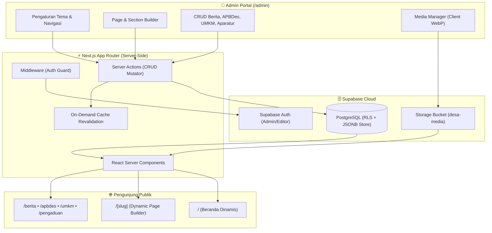

<div align="center">

  

  # SISTEM INFORMASI DESA KHEPONG JAYA
  ### Portal Web Desa Modern 100% Dinamis (Zero-Hardcoded) & Terintegrasi

  [-black?style=for-the-badge&logo=next.js)](https://nextjs.org/)
  [](https://react.dev/)
  [](https://supabase.com/)
  [](https://tailwindcss.com/)
  [](https://www.typescriptlang.org/)

  <p align="center">
    <strong>Kecamatan Padang Cermin, Kabupaten Pesawaran, Provinsi Lampung</strong><br />
    <em>Maju, Mandiri, Berbudaya, dan Sejahtera</em>
  </p>

</div>

---

## 📌 Tentang Proyek

**Sistem Informasi Desa Khepong Jaya** adalah platform digital pelayanan dan keterbukaan informasi publik desa yang dibangun dengan standar performa modern. Seluruh konten teks, warna tema CSS, susunan navigasi, tata letak beranda, hingga halaman tambahan dikelola secara **100% dinamis (Zero Hardcode)** melalui Admin Panel tanpa perlu mengubah kode sumber atau *re-deploy*.

---

## ✨ Fitur-Fitur Utama (Sesuai PRD)

### 1. 🌐 Zero Hardcode & Dynamic Theme Injection
- **CSS Variables Dinamis**: Pengaturan warna primer (`--primary`), warna aksen (`--accent`), dan jenis huruf dapat diubah sewaktu-waktu melalui Admin Panel dan langsung diterapkan ke seluruh halaman.
- **Menu Navigasi Bertingkat (CRUD Menu)**: Menambah, mengedit tautan, dan menyusun sub-menu dropdown header secara fleksibel.
- **Identitas & Footer Dinamis**: Nama desa, logo, kontak WhatsApp, email pelayanan, dan sematan peta Google Maps terhubung ke database `site_settings` berbasis JSONB.

### 2. 🧩 Modular Dynamic Page Builder (`/[slug]`)
- **Catch-All Dynamic Routing**: Admin dapat membuat halaman baru tak terbatas (contoh: `/visi-misi`, `/sejarah`, `/karang-taruna`, `/bumdes`) yang otomatis live seketika.
- **5 Tipe Blok Konten**:
  - 📝 **Rich Text Block**: Tipografi artikel lengkap (heading, list, kutipan).
  - 🖼️ **Image Banner Block**: Foto resolusi tinggi dengan caption dan optimasi WebP.
  - ⚖️ **Split Content Block**: Tata letak berdampingan antara teks deskripsi dan gambar (posisi kiri/kanan).
  - 📂 **Document Download Block**: Kartu unduhan berkas PDF (Perdes, formulir warga, SK Kades) dengan info ukuran file.
  - 🎥 **Embed Block**: Sematan interaktif video profil YouTube dan peta wilayah.

### 3. ⚡ On-Demand Cache Revalidation
- Setiap aksi **Create, Update, atau Delete** di Admin Panel mengeksekusi `revalidatePath` di sisi server Next.js. Perubahan langsung tampil instan di web publik tanpa menunggu masa *cache expired* dan tanpa mengorbankan kecepatan loading Server Components.

### 4. 📊 Transparansi APBDes Real-Time
- Pelaporan anggaran terbuka untuk pos **Pendapatan Desa**, **Belanja & Pembangunan**, dan **Pembiayaan (SiLPA)**.
- Dilengkapi **kalkulasi otomatis persentase penyerapan**, progress bar visual, dan tabel rincian kegiatan per bidang.

### 5. 🛍️ Katalog Potensi & UMKM Desa
- Etalase digital karya warga desa (olahan kopi, keripik, kerajinan tangan).
- Fitur pemesanan langsung satu klik via tautan **WhatsApp resmi pemilik usaha** dengan pesan otomatis.

### 6. 📢 Layanan Aspirasi & Pengaduan Warga
- Formulir pengaduan publik yang dilengkapi fitur unggah foto bukti lapangan.
- **Client-Side Image Compression**: Otomatis mengompresi foto ke format WebP (<800 KB) langsung di browser warga sebelum diunggah ke storage.
- Pelacak status penanganan (*Menunggu Verifikasi*, *Sedang Diproses*, *Selesai Ditindaklanjuti*) disertai tanggapan resmi pemerintah desa.

### 7. 🛡️ Keamanan Berlapis & RLS (Row Level Security)
- **Supabase Auth**: Akses dashboard admin terlindungi melalui email & sandi.
- **Next.js Middleware**: Memfilter setiap rute `/admin/*` dari akses yang tidak terotorisasi.
- **PostgreSQL RLS Policies**: Publik hanya diberikan izin `SELECT` pada data aktif/diterbitkan, sedangkan operasi mutasi data wajib memiliki peran `super_admin` atau `editor`.

---

## 🏛️ Arsitektur Sistem



---

## 📁 Struktur Direktori

```text
├── app/
│   ├── (public)/                 # Halaman untuk pengunjung desa
│   │   ├── page.tsx              # Beranda (Hero Slider, Kades, Stats, Feed)
│   │   ├── berita/               # Warta berita & agenda kegiatan
│   │   ├── apbdes/               # Transparansi realisasi anggaran
│   │   ├── umkm/                 # Katalog produk & UMKM lokal
│   │   ├── pemerintahan/         # Struktur organisasi & aparatur
│   │   ├── galeri/               # Dokumentasi foto & video
│   │   ├── pengaduan/            # Form aspirasi & pelacak tindak lanjut
│   │   └── [slug]/               # Catch-all Dynamic Page Builder
│   ├── admin/                    # Admin Panel (Terproteksi Middleware)
│   │   ├── layout.tsx            # Sidebar admin, role badge, quick actions
│   │   ├── page.tsx              # Overview statistik operasional
│   │   ├── settings/             # Visual theme color picker & menu builder
│   │   ├── homepage/             # Urutan slider & sambutan kades
│   │   ├── pages/                # Editor modular block halaman dinamis
│   │   ├── berita/               # CRUD berita & kategori
│   │   ├── apbdes/               # CRUD pos anggaran & realisasi
│   │   ├── umkm/                 # CRUD produk UMKM & nomor WA
│   │   ├── aparatur/             # CRUD perangkat & pejabat desa
│   │   ├── pengaduan/            # Verifikator & responder laporan warga
│   │   └── media/                # Supabase Storage Media Library
│   ├── login/                    # Halaman autentikasi administrator
│   ├── not-found.tsx             # Halaman 404 desa responsif
│   └── layout.tsx                # Injeksi CSS Variables tema dinamis
├── components/
│   ├── blocks/                   # BlockRenderer (RichText, Split, Banner, dll)
│   ├── home/                     # Seksi beranda (HeroSlider, Greeting, Stats)
│   ├── public/                   # Komponen Navbar dinamis & Footer
│   ├── apbdes/                   # APBDes view & persentase kalkulator
│   └── admin/                    # Form manajemen CRUD & visual editor
├── lib/
│   ├── actions/mutations.ts      # Server Actions (Mutasi DB + revalidatePath)
│   ├── data/api.ts               # Data fetcher SSR dengan fallback aman
│   ├── supabase/                 # Supabase client, server, & middleware session
│   └── utils/compression.ts      # Kompresor gambar WebP sisi browser
├── public/
│   └── logo.png                  # Lambang resmi Kabupaten Pesawaran
└── supabase/
    └── schema.sql                # Skema DDL lengkap, RLS, Storage & Seed Data
```

---

## 🚀 Panduan Memulai Cepat (Quick Start)

### 1. Prasyarat Sistem
- **Node.js**: versi 18.x atau 20.x+ (rekomendasi LTS)
- **npm**: versi 9.x atau 11.x+
- Akun aktif di [Supabase](https://supabase.com)

### 2. Kloning & Instal Dependensi
```bash
git clone https://github.com/username-anda/desa-khepong-jaya.git
cd desa-khepong-jaya
npm install
```

### 3. Setup Database Supabase
1. Masuk ke dashboard proyek Supabase Anda.
2. Buka menu **SQL Editor** pada navigasi kiri.
3. Buka berkas `supabase/schema.sql` pada proyek ini, salin seluruh kodenya, tempelkan ke SQL Editor, lalu klik tombol **Run**.
4. Skema akan otomatis membuat:
   - Seluruh tabel relasional dan kolom JSONB.
   - Storage bucket `desa-media` berstatus *public*.
   - Hak akses RLS (Row Level Security).
   - Data inisial (*seed data*) Desa Khepong Jaya lengkap.

### 4. Konfigurasi Environment Variables
Salin file `.env.example` menjadi `.env.local`:
```bash
cp .env.example .env.local
```
Sesuaikan kunci API dari menu **Project Settings > API** di Supabase:
```env
NEXT_PUBLIC_SUPABASE_URL=https://<id-proyek-anda>.supabase.co
NEXT_PUBLIC_SUPABASE_ANON_KEY=<anon-key-anda>
SUPABASE_SERVICE_ROLE_KEY=<service-role-key-anda>
NEXT_PUBLIC_SITE_URL=http://localhost:3000
```

### 5. Jalankan Server Lokal
```bash
npm run dev
```

Buka peramban di:
- **Portal Publik Warga**: [http://localhost:3000](http://localhost:3000)
- **Panel Administrator**: [http://localhost:3000/admin](http://localhost:3000/admin) *(atau login melalui [http://localhost:3000/login](http://localhost:3000/login))*

---

## 📦 Perintah Skrip Tersedia

| Perintah | Deskripsi |
| :--- | :--- |
| `npm run dev` | Menjalankan server pengembangan lokal (hot reload aktif) |
| `npm run build` | Melakukan build produksi dan type-checking TypeScript |
| `npm run start` | Menjalankan server produksi hasil kompilasi build |
| `npm run lint` | Memeriksa kepatuhan kode menggunakan ESLint |

---

## 👨‍💻 Kontributor & Lisensi

Dikembangkan untuk **Pemerintah Desa Khepong Jaya**, Kecamatan Padang Cermin, Kabupaten Pesawaran, Lampung.

Hak Cipta © 2026. Seluruh hak cipta dilindungi undang-undang.
# -Sistem-Informasi-Desa-Khepong-Jaya

